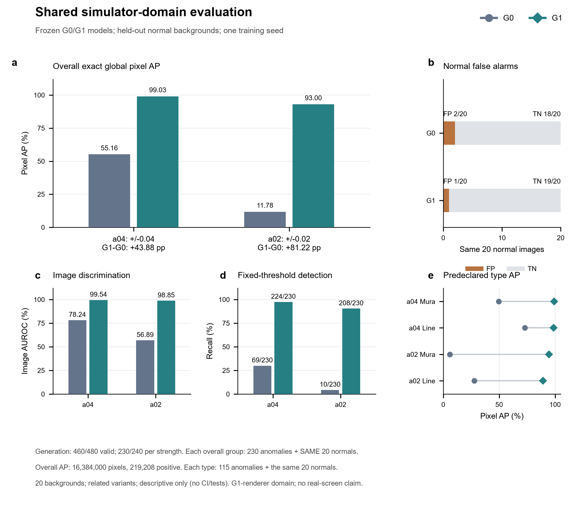
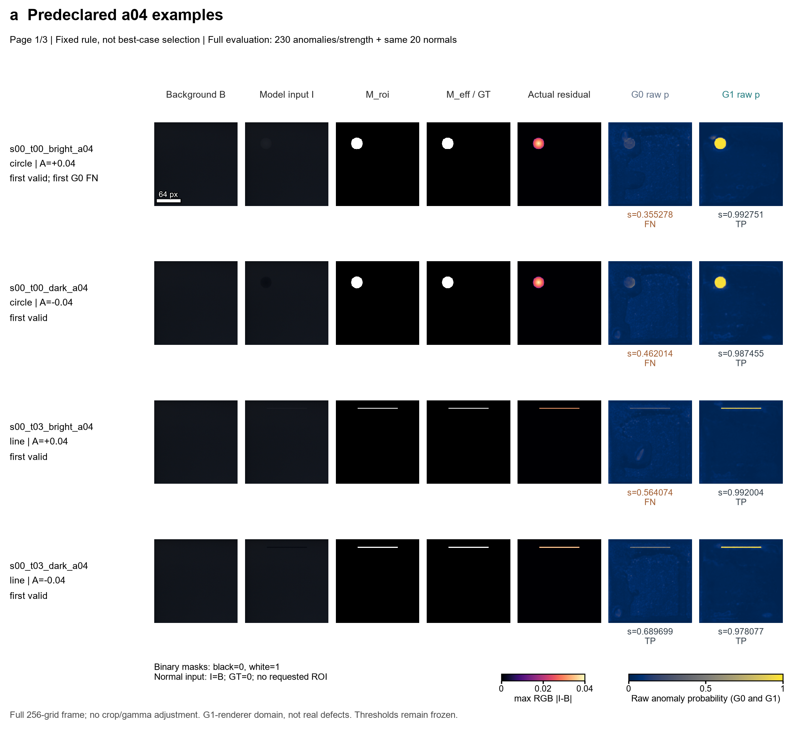
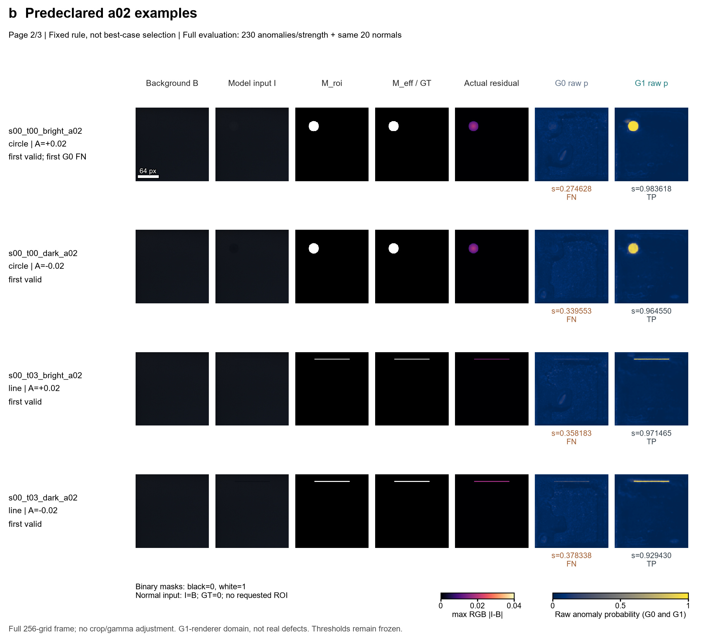
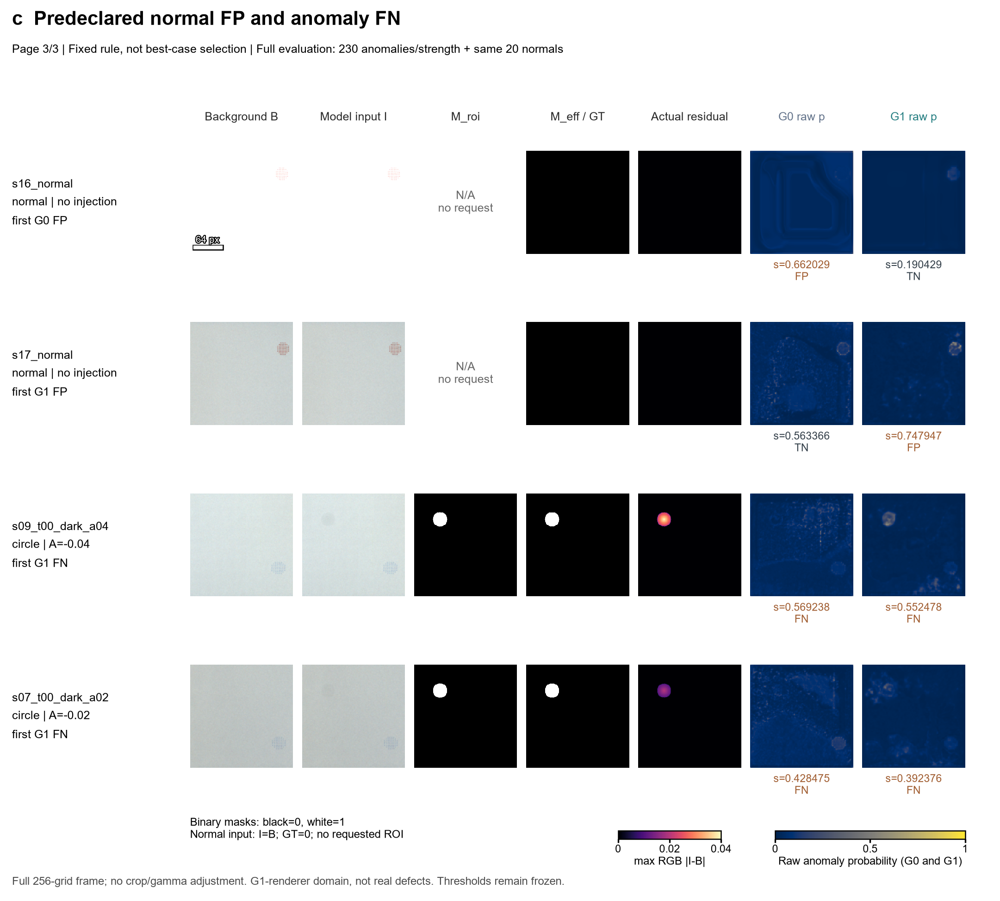

# 第10天图件说明与中文图注

本次仅整理第9天已冻结的共享模拟留出成果。新增一张指标图与一组定位对照图（3页、12个去重样例），未导入Torch、运行模型、生成新样本、训练或重校准。冻结指标、概率缓存与旧成果保持不变。主报告整合尚待下一项执行；新独立真实验证数据仍待核验。

## 图1：共享模拟域指标



**图1｜G1在共享渲染器模拟域上的定位与检出高于G0，但不足以证明真实屏幕收益。** a，精确全局像素平均精度（AP）。a04表示名义亮／暗幅度±0.04，a02表示±0.02；G0／G1在a04下分别为55.1564%／99.0349%，在a02下为11.7830%／93.0047%，G1−G0分别为+43.8784／+81.2217个百分点。AP使用保存的原始float32异常概率和实际有效残差标签，在每个完整评价组的所有像素上计算；本图复用冻结指标，未重新计算AP、抽样像素或平均逐图AP。b，共享20张正常输入上的固定阈值误报：G0为FP2/20、TN18/20，G1为FP1/20、TN19/20；仅画一遍，不能跨强度或子组累计为更多独立正常图。c，整图AUROC；整图分数为原始异常softmax概率图的最大值。d，固定阈值下的异常检出，柱顶为TP/230：a04下G0为69/230、G1为224/230，a02下分别为10/230、208/230；对应FN为161、6、220、22。e，预定Mura式／线状类型的全局像素AP；每类每强度包含115张有效异常和同一20张正常图。灰蓝色为G0，青色为G1；类型面板另外以圆点／菱形区分，两点连线只连接同一组的模型指标，不是误差线。正常误报面板棕色为FP、浅灰色为TN。

生成有效性为460/480（95.8333%），两强度各230/240；20个无效请求未补数、未作为正常或模型漏检计入。每强度模型评价分母为230张异常＋同20张正常，共250张、16,384,000像素，其中219,208为正像素。每类型为135张、8,847,360像素；Mura式正像素157,887，线状正像素61,321。正常FP率与异常召回率的分母分别为20和230，不能互换。主强度和弱强度为230对共同有效配对，重复使用20个背景；两强度的背景变体不是独立重复。

两模型均来自已冻结的最终10000步结果，训练初始化种子为20261030；本次仅有一个训练种子、20个留出背景，原始采集组独立性未确认。图中为描述性点估计，没有置信区间、显著性检验或多重比较结论。训练侧N_gen80、校准侧Q_cal40与留出侧S_bg20的既定分工不变；未重新访问训练或校准图像。本次留出图像由与G1相关的渲染方法和标签规则产生，即使背景留出，外观／模板机制仍偏向G1。较高模拟域指标及少1张正常误报均不能外推真实缺陷收益或稳定的生产误报率。

指标来源：[metrics.json](../metrics.json)、[metrics_verification.json](../metrics_verification.json)；绘图数值摘录：[metrics_source.csv](metrics_source.csv)。该CSV为图件源数据，12行为两强度×总体／两类型×两模型，不表示12次独立实验。

## 图2：预定样例的G0／G1定位对照







**图2｜固定规则选取的12个样例同时展示定位、正常误报和异常漏检。** a，a04下Mura式／线状×亮／暗各自首个有效例，共4例。b，a02对应4例。c，按冻结规则追加并去重后的G0首正常FP、G1首正常FP、G1在a04和a02的首异常FN，共4例。G0两强度的首异常FN已分别包含在a和b的第一行，不重复增加样例；同一正常FP在两强度中的选择原因也合并保留。所有样例及理由直接复用metrics_verification.json的figure_sample_selection，未按视觉效果或概率挑图。

各行依次为缓存背景B、实际模型输入I、请求区域M_roi、实际有效残差掩码M_eff、实际残差D、G0及G1原始异常概率。D=max_RGB|I−B|，在生成后的float32图上计算；M_eff为D>float32(1/255)，标签不是直接用M_roi替代。实际掩码与残差从已冻结数组读取，并核验其数值关系和文件身份。左侧A为请求的有符号幅度；实际残差可能因羽化、背景饱和或裁剪而小于名义幅度，逐例ROI内最小／中位／最大残差、ROI及有效面积见examples_source.csv。全部图像采用完整256×256工作网格，无裁剪、拼接、伽马或对比度增强；显示采用最近邻插值。第一列64 px尺仅表示工作网格像素，不表示物理长度。

RGB使用原缓存[0,1]数值；二值掩码黑=0、白=1。三页所有残差图统一使用magma色图及范围[0,0.04000002145767212]，两模型全部概率图统一使用cividis色图及范围[0,1]，没有逐图拉伸、平滑或阈值化显示。残差色条刻度0.04是便于阅读的近似刻度，上限仍为0.04000002145767212；a02的实际最大残差上限为0.02000001072883606。PNG用于图件预览，科学输入／标签仍来自float缓存，不以PNG量化差异替代实际M_eff。

模型下方s为原始概率最大值（显示保留6位小数）；TP／FN／FP／TN用未舍入分数与原冻结阈值严格比较得到：G0 τ=0.6124536782503127，G1 τ=0.7155899673700332，只有s>τ判为异常。阈值源于既有Q_cal40的q=0.95、linear规则，未因展示样例而修改。正常两行无合成注入，I=B，保存的正常GT全0、残差全0；没有请求区域，M_roi列明确写为N/A，不伪造正常缺陷区域。

按冻结顺序展示的ID与完整选择原因保存在[examples_source.csv](examples_source.csv)。前8个“首有效”例恰好全部来自s00，另4例来自s16、s17、s09、s07，因此12个展示输入只有5个不同背景，不代表12个独立背景，也不代表数据外观多样性。正常图按数据集与协议作为正常输入；不能仅凭图上纹理将其重新标成异常。图中个例用于解释已保存评分及失败形式，整体结论的分母仍为每强度230异常＋同20正常；不能用展示例数量替代评价分母。此图同样受G1共享渲染器偏好限制，不是新独立真实屏幕评价。

## 导出、来源和运行

图1为单页[PDF](figure1_shared_metrics.pdf)；图2为[3页PDF](figure2_localization.pdf)。每张／每页均为183×165 mm，同时保存可编辑文本SVG、300 dpi PNG及600 dpi LZW TIFF（与各预览同名）。指标图采用定量面板布局，以总体AP为主、正常误报为约束、AUROC／召回／类型AP为补充；定位图采用同列同范围图像对照，保留错误例。正文及刻度使用Arial，SVG保留文本，PDF嵌入TrueType字体；栅格图像内容保持其256网格信息，600 dpi导出不增加原图细节。

独立绘图模块为controlled_generation/holdout_figures.py；未改旧CLI、渲染、训练、评分或指标模块。它仅读取shared_holdout_v1内的冻结指标、身份元信息和选定数组，先核验指标／manifest／分数／所选数组的SHA256，再绘图；不打开原始数据集、权重或真实评价。来源指纹、固定样例／选择原因、显示范围、导出文件指纹及导出核验保存在[figure_audit.json](figure_audit.json)。原始训练／划分／阈值身份承接冻结指标，不在本图件任务中重新加载模型核验。

已实现的PowerShell入口：

```powershell
Set-Location -LiteralPath 'D:\华兴源创\实验\弱缺陷Demo'
& '.\.venv\Scripts\python.exe' -m controlled_generation.holdout_figures
```

当前图件完整时，此命令核验同身份源缓存和导出文件，输出FIGURE_CACHE_VERIFIED；不会自动重画或执行推理。输入或导出身份不一致则停止，保留文件查因。无需GPU；绘图与核验只需Python、NumPy、Matplotlib和Pillow，PDF导出检查使用既有Python工具包。无需下载数据、权重或素材。

导出后已逐页查看全部4张PNG画布及12个样例，调整了两种色条的间距；检查无画布外文字。4个SVG保留文本节点；两份PDF共4页均为规定尺寸、文本可提取且TrueType字体已嵌入；PNG为2161×1948、约300 dpi，TIFF为4322×3897、600 dpi。TIFF dpi元信息的特殊分数类型经显式数值转换后完成记录，不修改图像。绘图运行中封锁Torch导入及模型／生成调用，实际触发次数均为0；源缓存绘图前后哈希一致。此为图件交付核验，不增加软件测试套件或过程表。

下一项仅将本图件、中文图注与既有生成控制／模拟域结论整合到主报告，保留历史实验结果及真实验证延期说明；本次不代替报告整合或新独立验证。
