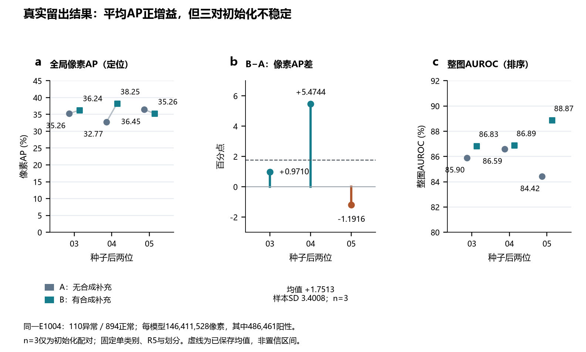
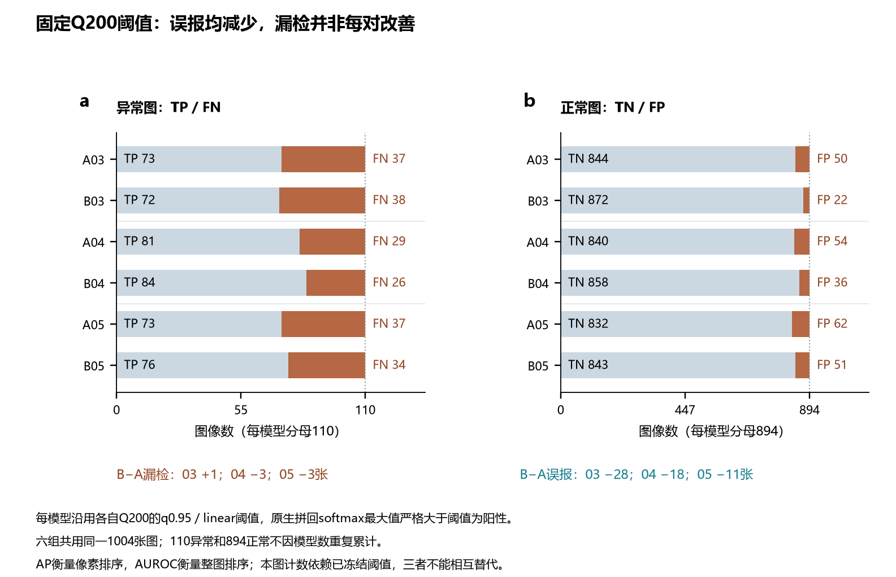
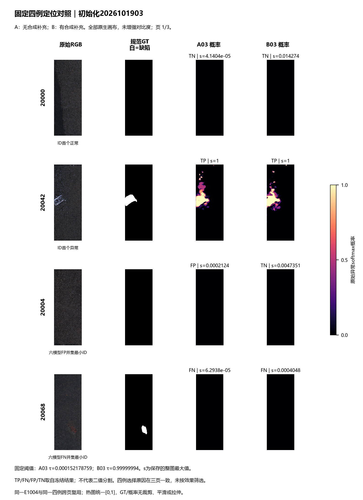
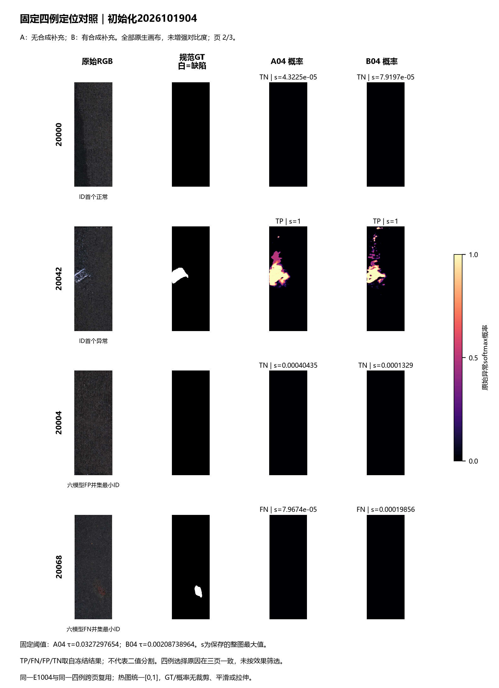
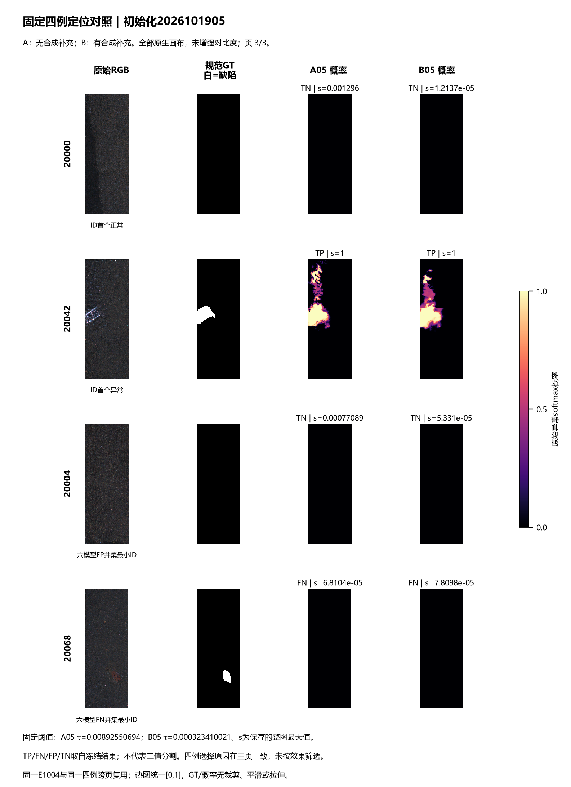

# 第7天真实工业缺陷实验图件与中文图注

本组图回答：在固定5张真实异常训练图及同一真实评价划分上，用可控合成替代部分正常曝光，能否改善缺陷定位？图件完整展示三对初始化；已冻结的平均像素AP增益为正，但方向与幅度不稳定。它不是总体显著性或可控外观逼真的证据，也不是显示屏效果。

## 图1：三对像素AP、配对差与整图AUROC



**中文图注。** a，A为无合成补充，B为有合成补充；展示2026101903／04／05全部最终10000步模型的全局像素AP，按完整原生像素共同排序，原结果未重算。b，对应B−A分别为+0.9710、+5.4744、−1.1916个百分点；冻结均值+1.7513，样本SD3.4008（ddof=1，n=3初始化配对）。虚线仅表示均值，不表示置信区间；05的负差完整保留。c，六模型整图AUROC仅衡量整图排序，纵轴80—92%已明确标注，与像素定位AP分开展示。A/B AP依次35.2649／36.2359%、32.7732／38.2476%、36.4531／35.2615%；AUROC依次85.8959／86.8339%、86.5924／86.8894%、84.4173／88.8702%。三对共用同一E1004与同一R5／划分，不是三个独立数据集。

## 图2：六模型固定阈值下的完整计数



**中文图注。** a，110张真实异常的TP／FN；b，同一894张真实正常的TN／FP。A03=73／37／50／844、B03=72／38／22／872；A04=81／29／54／840、B04=84／26／36／858；A05=73／37／62／832、B05=76／34／51／843，顺序均为TP／FN／FP／TN。三对FP分别减少28／18／11张，FN变化+1／−3／−3张；03存在漏检代价，不能称全面改善。每模型分别使用原Q200的q0.95／linear阈值，原生拼回概率最大值严格大于τ判异常；没有根据E调阈值。Q同池FP不是独立验证。本图为整图决策计数，不是像素分割阈值评价；其含义不同于AP或AUROC。

## 图3：固定四例的完整定位对照（三页）

固定顺序为20000（ID首个正常）、20042（ID首个异常）、20004（六模型FP并集ID最小者）、20068（六模型FN并集ID最小者）。所有选择及原因直接复用metrics.selected_examples，不重新挑图；FP／FN并集选例不意味着每个模型对此例都误报／漏检。







**中文图注。** 三页分别为初始化2026101903／04／05，每页四行按上述固定顺序，四列分别为原始RGB、规范GT、A概率、B概率。白色GT为缺陷，黑色为背景；仅读取已封存规范标签。所有概率图统一magma色图与[0,1]线性范围，显示完整原生画布，不做局部裁剪、平滑、阈值化、对比度增强或逐图归一化。RGB沿用原始uint8显示；图像宽高比例保留，版面缩放为最近邻。概率图上方s为原缓存最大值，TP／FN／FP／TN直接引用冻结FP/FN列表与规范标签元信息；该标记是整图决策，并非分割质量。阈值显示在页脚。低响应在统一[0,1]范围内可能近黑，但较低整图阈值仍可产生FP；不为突出差异而拉伸色阶。四例跨页重复仅为比较六模型，不增加图像分母；不根据定位观感推断可控生成逼真度。

## 共同分母、方法边界与复用

所有指标使用同一1004张唯一真实E图：110异常／894正常；每模型146411528个原生像素，其中486461阳性。六模型不构成6024张独立评价图，正常分母也不累加。全局像素AP、整图AUROC与固定阈值计数均直接复制冻结metrics.json；绘图不重算任何指标、实际分位数或像素AP。A与B不仅合成曝光不同，正常／异常曝光组成也不同，不能把差异归因为外观逼真或控制能力本身。

结果来自KolektorSDD2单产品域、固定5张真实异常与固定划分、3个初始化。平均正增益但不稳定；没有总体显著性结论，也不能外推真实显示屏、Mura或其他产品。原始RGB只读取冻结四例；原GT文件、其他RGB、Q／U图像和概率均未读取，规范GT只读四份既有缓存。全六组指标核验及封存引用已核对，本轮只复核用于绘图的四例24份概率／6份scores／4份规范GT与RGB身份，不重复扫描47.6GiB精确AP表。

PNG为220dpi预览；单页PDF／SVG为矢量文字与线条，TIFF为600dpi LZW，完整画布183mm宽。图3单页高252mm，另有三页合并PDF。PDF／SVG内图像的版面重采样不增加原生信息。CSV是绘图所用冻结数值及样例原因的源数据。source_identity.json保存读取来源hash，complete.json保存最终图件身份；visual_verification.json说明图件核验范围。未新增模型操作、训练、生成、重校准或实验结论。


## 已实现的只读复核入口

```powershell
Set-Location -LiteralPath 'D:\华兴源创\实验\弱缺陷Demo'
& '.\.venv\Scripts\python.exe' -B -X utf8 -m fewshot_synthetic.real_figures verify
```

该命令只核验图件及已消费来源hash，不重新绘图、解码原图、加载数组或计算指标。generate在完整封存存在时也只核验复用；不完整或未知目录保留停止。图中阈值数值仅引用既有Q summary标量及来源hash，未读Q图像／概率或重取分位数。图件已经完成，无需重新生成。
