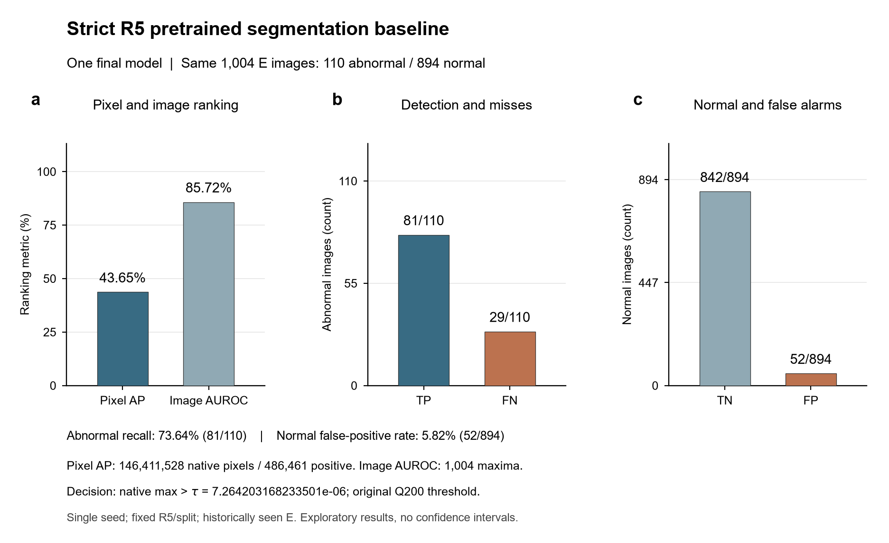
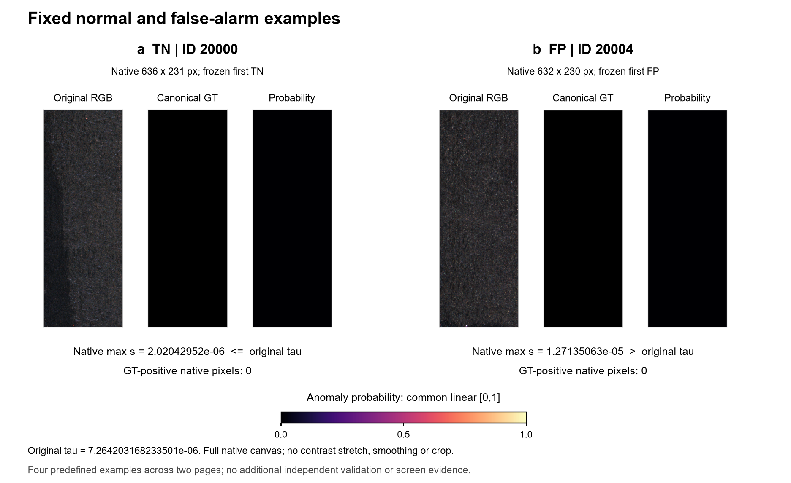
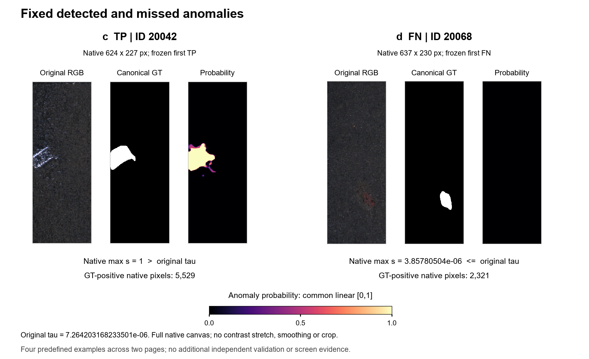

# 第7阶段图件与中文图注

本套图仅呈现冻结真实指标和四个预定样例。Python／matplotlib为唯一绘图、预览、导出和视觉核验后端；无模型导入、前向、训练、生成、重校准、阈值修改或指标重算。只打开20000／20004／20042／20068四张原始RGB；GT只读既有规范标签缓存，不读取原GT。固定指标及全部旧成果保留不变。

## 图件论证与完整性

核心结论：当前单seed纯真实基线同时存在有限像素定位排序、29/110漏检和52/894正常误报，指标及四例提供可追溯的探索性基线，不支持效果达标、稳定增益或屏幕收益。图1为quantitative grid，a定位／整图排序、b异常检出／漏检、c正常正确／误报分别回答不同问题；图2为image plate + quant，以完整原生三列对照承载定性证据，原生max和原τ承载决策依据。图件不将AP与AUROC当相同能力，也不从四例推断总体原因。

图1最终183×112mm；图2两页各183×112mm。SVG保留可编辑文字，PDF嵌入TrueType字体；TIFF600dpi无损LZW，PNG为260dpi预览。GT使用固定黑白0／1；概率magma固定线性[0,1]，原始uint8 RGB不做对比度／亮度／gamma变换，全部显示原生完整画布、保持宽高比，仅以nearest作版面显示，不裁剪、平滑、阈值化或逐图归一化。不改变或重存输入图像；无物理长度标定，不虚构微米尺度，原生尺寸以px注明。四例跨格式／分页复用不增加独立图像分母。

## 图1 | **纯真实预训练单头基线的排序指标与固定阈值结果**

**a**，全局像素AP43.65305632%，整图AUROC85.71842587%；AP汇总146,411,528原生像素，其中486,461阳性，未平均逐图AP。AUROC使用同一1004图的原生概率max。**b**，110张异常中TP81／FN29，召回81/110=73.63636364%。**c**，同一894张正常中TN842／FP52，正常误报52/894=5.81655481%。b、c的计数轴和分母不同，不比较柱高推断错误率。蓝／灰蓝表示各排序或正确结果，棕色与FN／FP文字明确标识错误。阈值为原Q200冻结τ=7.264203168233501e-06，score严格大于τ判异常，未重校准。全部数值直接来自保存指标；图中百分比仅为显示格式转换。一个最终10000步模型、一个初始化seed，共同R5／N1885训练与Q200校准；E为历史已见的同一1004图，采集分组未知，不把像素／窗口当独立工件。无多seed分布、误差条、置信区间或显著性检验，不支持稳定提升、预训练因果或屏幕效果。源数据见source_metrics.csv。

## 图2 | **固定正常、误报、检出与漏检样例的原生定位对照**

**a**，ID20000，为原E顺序首个TN；原生636×231像素，GT阳性0，保存max=2.02042951968906e-06≤原τ。**b**，ID20004，为首个FP；原生632×230，GT阳性0，max=1.271350629394874e-05>原τ。**c**，ID20042，为首个TP；原生624×227，GT阳性5529，max=1>原τ。**d**，ID20068，为首个FN；原生637×230，GT阳性2321，max=3.857805040752282e-06≤原τ。两页依次显示a／b与c／d；各例三列为原始RGB、规范GT（白=缺陷／黑=正常）和异常概率。所有概率共用magma／[0,1]线性色阶，原图不拉伸，完整原生画布无裁剪。原τ=7.264203168233501e-06；整图TP／FN／FP／TN只由原生max决定，不代表像素轮廓质量。FP例虽在统一色阶下近暗，其max仍超过原τ；FN例GT非空而max未过阈值，不通过拉伸概率图救观感。四例原先已按对应类型首个ID冻结，保留全部原选择理由，不挑最佳例，不能代表总体分布或定位失败根因。总体仍是同一1004唯一图／110异常／894正常、146,411,528像素／486,461阳性；四例及两页不另加到分母。单seed／固定R5与划分／单类别／未知采集分组、E已见，只作探索性描述，无训练收益或屏幕效果结论。源数据见source_examples.csv。

## 来源与运行

source_identity.json保存冻结指标／证据／元信息以及四例RGB／规范GT／原生概率的实际绑定hash；源数据CSV只抄录保存值，不调用AP、AUROC或模型。构图脚本为build_figures.py，唯一显式入口为在项目CPU环境运行该脚本；完整同身份图件只核验复用，未知或部分输出停止保留。图件完整清单见complete.json；视觉核验说明见visual_qa.json。

本任务只整理图件和中文图注，不撰写最终研究报告、不读取额外RGB／原GT或自动进入新实验。所有训练仍由用户手动启动。
